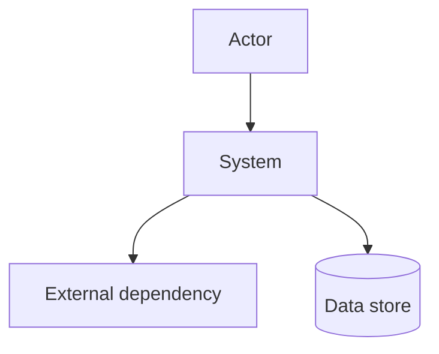
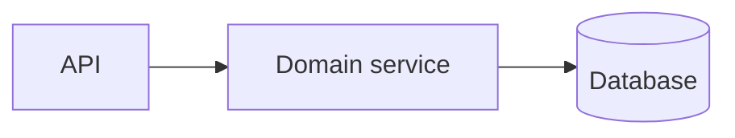

# ARCHITECTURE.md Template

> Guidance comments are blockquotes. Replace every bracketed placeholder; remove guidance before approval.

## Document Control

> Record status, version, owners, reviewers, approval date, and superseded documents.

| Field | Value |
|---|---|
| Status | Draft / Approved / Superseded |
| Version | [semver] |
| Owners | [names/teams] |
| Reviewers | [architecture, security, operations] |
| Last updated | [YYYY-MM-DD] |

## System Overview

> State the problem, users, observable outcome, scope, non-goals, constraints, assumptions, and success metrics.

- **Problem:** [why this exists]
- **Primary actors:** [human and machine identities]
- **In scope:** [capabilities]
- **Out of scope:** [explicit exclusions]
- **Success metrics:** [metric, threshold, window, environment]

## Context Diagram

> Show actors, external systems, data flows, protocols, ownership, and trust boundaries. Follow the diagram with prose that names every element.

| Flow | Source | Destination | Data class | Protocol | Authentication |
|---|---|---|---|---|---|
| F-001 | [source] | [target] | [class] | [protocol] | [method] |

## Component Architecture

> Define one responsibility, owned data, interfaces, scaling unit, and failure boundary for each component.

| Component | Responsibility | Inputs/outputs | Owned state | Failure behavior | Owner |
|---|---|---|---|---|---|
| C-001 | [single responsibility] | [contracts] | [state or none] | [degrade/retry/fail] | [team] |

## API Contracts

> Include authorization, idempotency, schemas, error taxonomy, pagination, limits, versioning, and compatibility.

### API-001 — [operation]

- **Actor and authorization:** [principal, policy]
- **Request:** [method/path/topic and schema reference]
- **Response:** [status/message and schema reference]
- **Idempotency:** [key, lifetime, duplicate behavior]
- **Errors:** [code, condition, retryability]
- **Limits:** [rate, payload, timeout]
- **Compatibility:** [versioning and deprecation]

## Data Model

> Define identifiers, required/nullable/default rules, units, invariants, retention, classification, lineage, and migration.

| Entity/field | Type | Constraints | Classification | Retention | Encryption/masking |
|---|---|---|---|---|---|
| [entity.field] | [type] | [invariant] | [Public/Internal/Confidential/Restricted] | [duration] | [control] |

## Integration Points

| Integration | Contract | SLA/timeout | Retry/idempotency | Failure mode | Owner |
|---|---|---|---|---|---|
| [system] | [API/event/version] | [threshold] | [policy] | [fallback] | [owner] |

## Security Threat Model

> Identify assets, adversaries, entry points, trust boundaries, and STRIDE threats. Link controls to abuse-case tests.

| Threat ID | STRIDE | Asset/flow | Scenario | Control | Test | Residual risk |
|---|---|---|---|---|---|---|
| THR-001 | [category] | [target] | [abuse case] | SEC-001 | [test ID] | [rating/owner] |

## TDD Rubric

| Test ID | Requirement | Layer | Setup/data | Stimulus | Assertions | Threshold | Evidence |
|---|---|---|---|---|---|---|---|
| T-001 | FR-001 | Unit/contract/integration | [fixture] | [action] | [observable outcome] | [exact pass rule] | [artifact] |

> Cover happy, invalid, boundary, unauthorized, concurrent, dependency-failure, recovery, and compatibility behavior. Require red–green–refactor evidence.

## Acceptance Criteria

### AC-FR-001-01 — [scenario]

- **Given** [specific actor and initial state]
- **When** [single action/event]
- **Then** [observable result with threshold]
- **And** [side effect, audit record, or invariant]

## Non-Functional Requirements

| ID | Attribute | Workload/environment | Metric | Threshold/window | Verification |
|---|---|---|---|---|---|
| NFR-LAT-001 | Latency | [load/region] | p95 | [value/time window] | [test] |

Include availability, recovery, capacity, consistency, accessibility, observability, privacy, security, and cost budgets where applicable.

## Delivery, Migration, and Recovery

- **Rollout:** [phases, gates, health metrics]
- **Migration:** [compatibility and backfill]
- **Rollback:** [trigger, steps, data constraints]
- **Backup/restore:** [RPO/RTO and verification]

## Decision Log

| ADR | Decision | Rationale/trade-off | Alternatives rejected | Date/owner | Revisit condition |
|---|---|---|---|---|---|
| ADR-001 | [decision] | [why] | [options] | [date/owner] | [trigger] |

## Traceability Matrix

| Requirement | Acceptance criteria | Tests | Task | Evidence | Status |
|---|---|---|---|---|---|
| FR-001 | AC-FR-001-01 | T-001 | TASK-001 | [path/link] | Planned |

## Risks and Open Questions

| ID | Risk/question | Impact | Owner | Due date | Resolution/mitigation |
|---|---|---|---|---|---|
| R-001 | [uncertainty] | [material consequence] | [owner] | [date] | [action] |

## Glossary

| Term | Normative definition | Not to be confused with |
|---|---|---|
| [term] | [single precise meaning] | [near synonym] |
