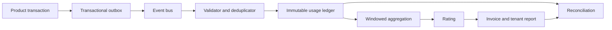
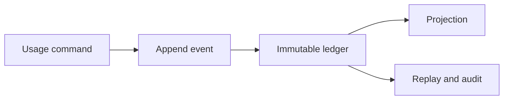
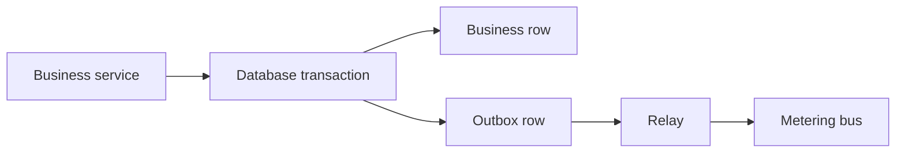
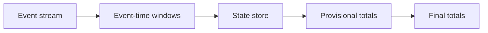
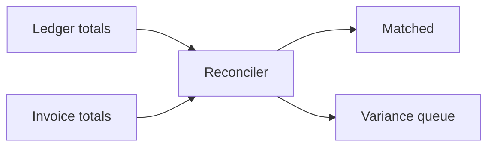

# Metering Architecture Patterns

## Reference pipeline

Separate immutable measurement, aggregation, rating, invoicing, and collection. This makes late data, pricing changes, credits, and disputes reproducible.

## Event sourcing for metering

Store every accepted usage event as append-only evidence. Each event needs globally unique identity, tenant derived from trusted context, metric and unit, exact quantity, event time, ingestion time, producer/schema version, and idempotency key. Corrections append reversals or adjustments that reference the original.

**Strengths:** replayable aggregates, transparent disputes, historical pricing reconstruction, and strong audit evidence. **Trade-offs:** storage growth, schema evolution, replay tooling, and deletion/privacy design. **Failure modes:** duplicate application, missing sequence ranges, applying current prices to old events, and mutation that destroys evidence.

Use when invoices are material, pricing evolves, or multiple consumers need consistent history. Partition on a stable billing subject while mitigating hot tenants.

## Transactional outbox

Write the business outcome and an outbox record in one local database transaction. A relay publishes the outbox record, then marks or checkpoints it. Consumers remain idempotent because publication can repeat.

**Strengths:** prevents successful billable work without a corresponding event. **Trade-offs:** relay lag, outbox cleanup, ordering per aggregate, and duplicate delivery. **Failure modes:** relay checkpoint before durable publish, unbounded outbox growth, payload schema drift, and events emitted before the business success state.

Do not use an independent “write then publish” sequence for chargeable actions unless compensating reconciliation can prove completeness.

## Streaming aggregation

### Tumbling windows

Each event belongs to one non-overlapping interval. This maps well to hourly/daily usage and billing periods. Define timezone, event-time boundaries, watermark, and finalization. Late events should update a provisional window or append an adjustment after close.

### Sliding windows

Overlapping windows support rolling quota, anomaly, and rate views. They cost more state and can count one event in multiple evaluations. Sliding windows should not become invoice quantities unless the commercial definition explicitly requires them.

### Session windows

Group activity separated by inactivity. Useful for billable sessions, but sensitive to late events and timeout semantics. Version the gap rule.

**Trade-offs:** streaming provides low-latency totals but introduces state, watermark, checkpoint, and reprocessing complexity. **Failure modes:** processing-time aggregation instead of event time, daylight-saving ambiguity, dropped late events, double application after restart, and state-store corruption. Persist source offsets and aggregate version for lineage.

## Batch reconciliation pattern

Periodically compare control totals across producer, bus, raw ledger, aggregate, rating, provider export, invoice, and tenant statement. Reconciliation keys should include tenant, metric, period, unit, currency, and price version.

Classify variance as timing, duplication, missing data, mapping, rate, rounding, adjustment, or provider state. Define absolute and percentage tolerances, but never hide a material amount behind a percentage. Freeze finalization above policy thresholds.

**Trade-offs:** batch checks are comprehensive and reproducible but detect issues later and require close coordination. **Failure modes:** comparing unlike periods or versions, tolerances that hide material amounts, non-idempotent repairs, and finalizing before unresolved variances close.

Batch reconciliation is mandatory even with streaming computation. Streaming gives responsiveness; reconciliation gives financial confidence.

## Delivery semantics

### Exactly-once effect

Infrastructure claims of exactly-once are bounded by a system and transaction domain. End-to-end billing still needs stable event identity and idempotent effects. Commit consumed offsets atomically with durable ledger writes when supported.

### At-least-once with deduplication

The practical default. Producers retry with the same key; consumers record accepted keys in a scope whose retention exceeds retry/replay windows. Apply the ledger append and dedup marker atomically. Replays must produce the same logical result.

### At-most-once

Avoid for billable events because loss is silent. It may suit non-authoritative preview telemetry only.

## Reliability controls

- Durable raw ledger before acknowledgment.
- Dead-letter quarantine with reason, payload hash, source position, and repair workflow.
- Bounded retries with jitter and visibility.
- Watermarks and explicit provisional/final states.
- Backpressure and per-tenant fairness.
- Versioned schema, aggregation, and rate cards.
- Completeness, duplicate, lateness, and reconciliation metrics.
- Backfill isolation and dry-run comparison.
- Encryption, tenant authorization, retention, and audit access.

## Architecture decision matrix

| Need | Recommended pattern | Avoid |
|---|---|---|
| Atomic billable action capture | Transactional outbox | Best-effort publish after commit |
| Auditable history and repricing | Immutable event ledger | In-place total updates |
| Near-real-time quota visibility | Streaming aggregate plus authoritative ledger | Invoice provider as live quota source |
| Contractual period close | Batch reconciliation and finalization gate | Time-based close without control totals |
| High duplicate probability | At-least-once plus durable dedup | Trusting queue semantics alone |
| Late data | Event-time windows plus adjustment policy | Silent discard |

## Operational invariants

1. Unique accepted events equal immutable ledger entries.
2. Aggregate equals included events plus explicit adjustments.
3. Every rated quantity references aggregate and rate-card versions.
4. Provider exports can be reconstructed exactly.
5. Tenant reports and invoices derive from the same finalized ledger.
6. Unknown, late, duplicate, and poison events have visible outcomes.

A pipeline is not reliable because it never retries; it is reliable when any retry, replay, delay, or partial failure converges to one explainable charge.