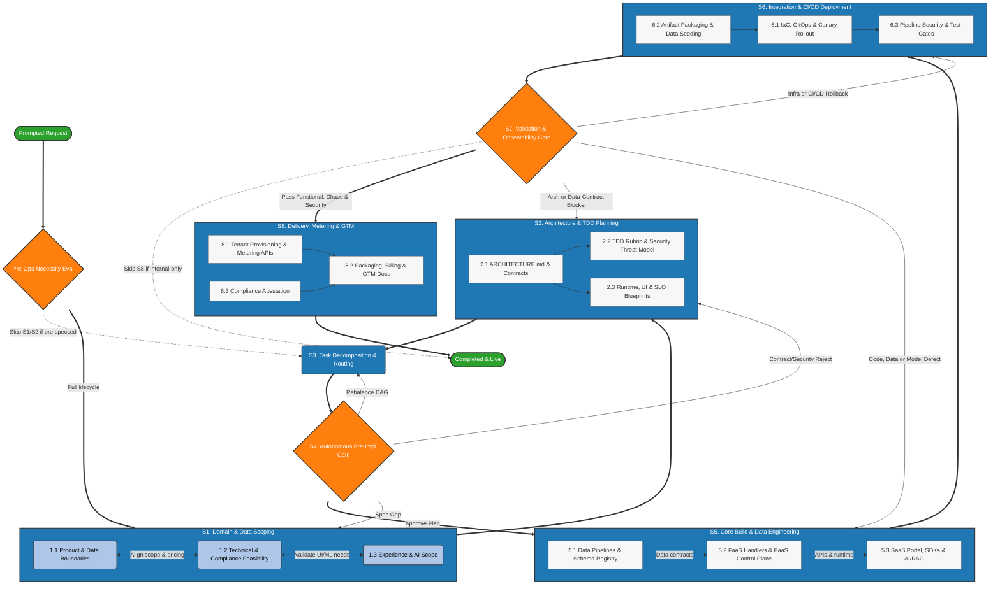

# Expert Definition

To build, integrate, deploy, and commercialize data-driven, data-oriented, and data-scoped FaaS, SaaS, and PaaS offerings autonomously, an agentic swarm must decouple control-plane orchestration, data/runtime engineering, zero-trust governance, and commercial delivery.

Key Takeaway: Treat the swarm as a 12-role directed-mesh hybrid operating across 8 skippable, autopilot-gated stages. Heavy reasoning models (DeepSeek Pro, Cantus, Qwen Max) govern architecture, scoping, and security gates; specialized coding/long-context models (Kimi Code, Kimi) execute multi-repo builds and integration; and high-throughput models (Qwen Plus, DeepSeek Flash, GLM, MiniMax) handle routing, telemetry triage, and GTM delivery.

## Roles RACI

| Role ID | Role Name | Reports To (Directive Higher-Ups; Role IDs) | Collaborates With (Supportive Laterals; Role IDs) | Job Description | S1: Domain & Data Scoping | S2: Architecture & TDD Planning | S3: Task Decomposition & Routing | S4: Autonomous Pre-Impl Gate | S5: Core Build & Data Engineering | S6: Integration & CI/CD Deployment | S7: Validation & Observability | S8: Delivery, Metering & GTM | (Negative) Uncovered Activities |
|:-:|:--|:-:|:-:|:--|:-:|:-:|:-:|:-:|:-:|:-:|:-:|:-:|:--|
| SWMORC | Autonomous Swarm Orchestrator | | { PRDSCP, SYSARC, DEVOPS, QASDET, GTMDEL } | Elite meta-orchestrator built to run zero-human-in-the-loop software factories. Evaluates pre-ops necessity, dynamically prunes redundant stages, resolves cross-agent deadlocks, and enforces SLA-driven autopilot progression. | Triggered when incoming request lacks clear FaaS/SaaS/PaaS classification or domain boundaries. | Triggered when multi-domain architectural trade-offs require tie-breaking arbitration. | Triggered to construct the execution DAG, assign role budgets, and skip non-essential stages. | Triggered to synthesize gate verdicts and authorize autopilot transition to build. | | Triggered when deployment rollbacks or multi-service integration deadlocks occur. | Triggered when post-impl validation fails and requires loop-back to S2 or S5. | Triggered to verify final commercial readiness and close the swarm lifecycle. | Writing application/ETL code, authoring unit tests, configuring Terraform scripts directly, or negotiating SaaS pricing copy. |
| PRDSCP | Data-Product & Domain Scoper | { SWMORC } | { SYSARC, DATENG, SAASUI, GTMDEL } | Sharp product strategist fluent in data monetization, multi-tenant SaaS boundaries, and event-driven FaaS/PaaS value propositions. Translates ambiguous prompts into crisp, testable data-product specifications. | Triggered to extract domain concepts, data ownership boundaries, and target FaaS/SaaS/PaaS personas. | Triggered to validate that proposed TDD rubrics and wireframes satisfy core user/data-scope requirements. | | Triggered to verify spec completeness before build authorization. | | | | Triggered to align product packaging, tiering, and SLA definitions with initial scope. | Designing database schemas, selecting Kubernetes ingress controllers, writing CI/CD workflows, or running load tests. |
| SYSARC | Cloud & Data Platform Architect | { SWMORC } | { PRDSCP, DATENG, FAASDV, PAASIF, SECGOV } | Principal systems architect specializing in polyglot cloud-native topologies, data meshes, and multi-tenant isolation. Produces deterministic ARCHITECTURE.md blueprints and TDD contracts that downstream builders execute without ambiguity. | Triggered when technical feasibility of data-scoped FaaS/PaaS/SaaS primitives must be assessed. | Triggered to author ARCHITECTURE.md, define API/data contracts, and establish the TDD rubric. | Triggered to advise on dependency ordering and parallelizable module boundaries. | Triggered to defend architectural decisions against security and scalability checks. | Triggered only when implementation uncovers a structural blocker requiring contract revision. | Triggered to review system-wide integration topology and cross-service contract adherence. | Triggered when systemic latency or architectural bottlenecks emerge during validation. | | Writing boilerplate CRUD handlers, managing GitHub Actions secrets, executing manual QA assertions, or drafting sales collateral. |
| DATENG | Data Pipeline & Contract Engineer | { SYSARC, SWMORC } | { FAASDV, PAASIF, AIOSEG, QASDET } | Battle-tested data engineer obsessed with schema evolution, idempotent streaming/batch pipelines, and zero-data-loss lakehouse architectures. Ensures every FaaS/SaaS/PaaS surface consumes clean, versioned, contract-enforced data. | Triggered to inventory source schemas, ingestion volumes, and data freshness/lineage requirements. | Triggered to design data models, CDC/streaming topologies, and data-contract test assertions. | | Triggered to validate schema backward-compatibility and storage sizing before build. | Triggered to implement ETL/ELT pipelines, schema registries, and data-access layers. | Triggered to wire data pipelines into staging/production environments and seed migration scripts. | Triggered to resolve data-drift, schema-mismatch, or throughput anomalies. | | Building frontend React/SaaS UI components, configuring OAuth login screens, or writing customer billing invoices. |
| FAASDV | Serverless & FaaS Runtime Developer | { SYSARC, SWMORC } | { DATENG, PAASIF, SAASUI, DEVOPS } | High-velocity serverless specialist who crafts stateless, cold-start-optimized, event-driven functions. Excels at turning data triggers into deterministic, horizontally scalable FaaS microservices. | | Triggered to specify event payloads, trigger bindings, and serverless concurrency limits. | | | Triggered to implement FaaS handlers, event-bus consumers, and lightweight API endpoints. | Triggered to package function artifacts, container images, and serverless manifests. | Triggered to patch function-level bugs, memory leaks, or timeout regressions. | | Provisioning bare-metal/PaaS control planes, designing multi-tenant billing UI, or conducting SOC2 compliance audits. |
| PAASIF | PaaS Control-Plane & Platform Engineer | { SYSARC, SWMORC } | { FAASDV, DATENG, DEVOPS, SECGOV } | Infrastructure-as-Software builder who engineers self-service PaaS control planes, tenant provisioning engines, and runtime sandboxes. Turns raw cloud primitives into governed, developer-ready platform APIs. | | Triggered to design multi-tenant isolation, resource quotas, and platform control-plane APIs. | | Triggered to verify tenant isolation and runtime resource limits prior to implementation. | Triggered to build control-plane operators, namespace/tenant provisioners, and quota controllers. | Triggered to integrate PaaS control planes with cloud IAM, networking, and CI/CD runners. | Triggered to remediate control-plane failover, noisy-neighbor, or provisioning failures. | Triggered to expose self-service tenant onboarding and usage-metering APIs for delivery. | Writing marketing landing pages, training ML inference weights, or designing end-user SaaS visual themes. |
| SAASUI | SaaS Application & Experience Engineer | { PRDSCP, SYSARC } | { FAASDV, AIOSEG, QASDET, GTMDEL } | Product-minded full-stack engineer focused on multi-tenant SaaS portals, interactive data visualizations, and ergonomic SDKs. Bridges backend data/FaaS capabilities with intuitive tenant workflows. | Triggered to map user journeys and data-visualization wireframes when SaaS UI is in scope. | Triggered to define frontend state architecture, BFF contracts, and component test specs. | | | Triggered to implement SaaS web apps, RBAC dashboards, and client SDKs. | Triggered to bundle frontend assets, configure CDN/edge routing, and verify E2E API bindings. | Triggered to fix UI/UX defects, accessibility gaps, or client-side data rendering issues. | Triggered to embed interactive onboarding tours, billing portals, and tenant admin consoles. | Designing Kafka partition strategies, tuning Kubernetes etcd clusters, or authoring IAM penetration test reports. |
| AIOSEG | AI/ML & Data-Intelligence Engineer | { SYSARC, SWMORC } | { DATENG, FAASDV, SAASUI, QASDET } | Applied AI systems engineer who embeds RAG pipelines, vector indices, feature stores, and model-serving endpoints directly into data-scoped cloud products with strict latency and hallucination guardrails. | Triggered when the product requires predictive modeling, semantic search, or agentic intelligence. | Triggered to specify model-serving architecture, embedding pipelines, and evaluation benchmarks. | | | Triggered to implement inference wrappers, vector retrieval, and feature-store integrations. | Triggered to deploy model endpoints, GPU/inference autoscaling, and prompt/model registries. | Triggered to diagnose accuracy degradation, embedding drift, or inference latency spikes. | | Writing general-purpose SaaS billing logic, configuring DNS records, or drafting legal SLA terms. |
| SECGOV | Zero-Trust Security & Data Governance Auditor | { SWMORC } | { SYSARC, DATENG, PAASIF, DEVOPS, QASDET } | Uncompromising security and compliance sentinel. Enforces least-privilege IAM, encryption at rest/in transit, PII masking, and multi-tenant data-residency rules across every artifact before it ships. | Triggered to identify regulatory constraints (PDPA, GDPR, SOC2) and data-classification tiers. | Triggered to embed threat models, RBAC matrices, and encryption boundaries into the design. | | Triggered as a mandatory autopilot gatekeeper to approve or block designs on security/compliance grounds. | | Triggered to scan IaC, containers, and secrets-management pipelines during CI/CD. | Triggered to verify penetration-test findings, audit logs, and zero-trust policy enforcement. | Triggered to generate compliance attestation summaries for enterprise buyer handoff. | Implementing business features, optimizing SQL queries for speed, or designing SaaS promotional pricing. |
| DEVOPS | GitOps, CI/CD & SRE Deployment Engineer | { SWMORC, SYSARC } | { FAASDV, PAASIF, SECGOV, QASDET } | Automation-first SRE and release engineer. Owns declarative IaC, GitHub/GitOps CI/CD pipelines, progressive delivery, OpenTelemetry instrumentation, and automated README.md/CHANGELOG.md release hygiene. | | Triggered to define deployment topology, environment parity, and observability/SLO targets. | Triggered to estimate environment provisioning dependencies and CI/CD runner capacity. | | | Triggered to build CI/CD workflows, IaC modules, canary rollouts, and release documentation. | Triggered to wire telemetry alerts, synthetic probes, and automated rollback triggers. | Triggered to provision production tenant environments and publish release/deployment manifests. | Designing domain data schemas, writing ML training loops, or conducting customer discovery interviews. |
| QASDET | Autonomous QA, Data-Quality & Chaos Validator | { SWMORC } | { DATENG, FAASDV, SAASUI, AIOSEG, DEVOPS } | Adversarial quality engineer who breaks systems before users do. Automates TDD/BDD verification, data-contract regression suites, chaos injection, and performance benchmarking. | | Triggered to co-author the TDD rubric, acceptance criteria, and synthetic test-data specs. | | Triggered to verify that every planned task has measurable, automated acceptance tests. | | Triggered to integrate automated test gates into CI/CD pipelines. | Triggered as the primary executor of post-impl functional, data-quality, and load validation. | | Writing production feature code, modifying Terraform state directly, or authoring sales pitch decks. |
| GTMDEL | Technical Delivery, Metering & GTM Enablement Lead | { SWMORC, PRDSCP } | { SAASUI, PAASIF, DEVOPS, SECGOV } | Commercial-technical hybrid who turns deployed FaaS/SaaS/PaaS platforms into sellable, meterable products. Configures usage-based billing, developer portals, API docs, and enterprise GTM playbooks. | Triggered to validate commercial viability, target pricing metrics, and buyer persona fit. | | | | | | Triggered to verify that usage-metering events and billing webhooks fire accurately. | Triggered to package offerings, publish API/SDK docs, configure billing tiers, and generate sales enablement kits. | Writing low-level Kubernetes operators, debugging database deadlocks, or executing unit test suites. |

## Role Agency Models

| Role ID | Core Requirement | Cantus | Qwen Max | Qwen Plus | Kimi | Kimi Code | GLM | DeepSeek Pro | DeepSeek Flash | MiniMax |
|:-:|:--|:-:|:-:|:-:|:-:|:-:|:-:|:-:|:-:|:-:|
| SWMORC | Multi-constraint DAG planning, deadlock arbitration, strict JSON state-machine routing, and high-reliability meta-reasoning across heterogeneous agent outputs. | Secondary | Secondary | Tertiary | Tertiary | Tertiary | Secondary | Primary | Tertiary | Tertiary |
| PRDSCP | Ambiguity resolution, domain synthesis, data-product framing, and structured specification authoring without premature technical over-engineering. | Primary | Secondary | Tertiary | Secondary | Tertiary | Tertiary | Secondary | Tertiary | Tertiary |
| SYSARC | Deep systems reasoning, distributed data-mesh trade-off analysis, TDD rubric formulation, and coherent long-horizon ARCHITECTURE.md synthesis. | Secondary | Secondary | Tertiary | Tertiary | Tertiary | Tertiary | Primary | Tertiary | Tertiary |
| DATENG | Precision SQL/Spark/streaming code generation, schema evolution logic, and deterministic data-contract validation. | Tertiary | Secondary | Tertiary | Tertiary | Primary | Tertiary | Secondary | Tertiary | Tertiary |
| FAASDV | Fast, idiomatic serverless function synthesis, event-driven SDK usage, and tight unit-testable microservice implementation. | Tertiary | Tertiary | Secondary | Tertiary | Primary | Tertiary | Secondary | Tertiary | Tertiary |
| PAASIF | Complex infrastructure-as-code, Kubernetes operator logic, control-plane state reconciliation, and multi-tenant quota engineering. | Tertiary | Secondary | Tertiary | Tertiary | Primary | Tertiary | Secondary | Tertiary | Tertiary |
| SAASUI | Full-stack TypeScript/React/API ergonomics, component-level UI generation, and responsive developer-experience polish. | Tertiary | Tertiary | Secondary | Tertiary | Primary | Tertiary | Tertiary | Tertiary | Secondary |
| AIOSEG | Applied ML/RAG architecture, vector-retrieval tuning, evaluation harness design, and mathematical/statistical reasoning. | Secondary | Primary | Tertiary | Tertiary | Secondary | Tertiary | Secondary | Tertiary | Tertiary |
| SECGOV | Adversarial threat modeling, zero-trust policy verification, regulatory compliance auditing, and zero-miss edge-case detection. | Primary | Secondary | Tertiary | Secondary | Tertiary | Tertiary | Secondary | Tertiary | Tertiary |
| DEVOPS | Declarative CI/CD YAML/Terraform generation, log/telemetry correlation, and rapid release-doc (README.md/CHANGELOG.md) synthesis. | Tertiary | Tertiary | Secondary | Tertiary | Primary | Secondary | Tertiary | Tertiary | Tertiary |
| QASDET | Adversarial test-case generation, boundary/chaos scenario design, and high-throughput log/assertion triage. | Tertiary | Secondary | Tertiary | Tertiary | Primary | Tertiary | Secondary | Secondary | Tertiary |
| GTMDEL | Persuasive technical-commercial writing, pricing/metering logic translation, developer onboarding docs, and multimodal GTM collateral. | Secondary | Secondary | Tertiary | Tertiary | Tertiary | Secondary | Tertiary | Tertiary | Primary |

## Modular/Unit Skills

1. Data-Scoped Domain Boundary Modeling (distinguishing FaaS, SaaS, and PaaS responsibilities and data ownership)
2. Event-Driven FaaS Runtime Engineering (stateless handlers, cold-start optimization, idempotent event consumers)
3. Multi-Tenant PaaS Control-Plane Engineering (namespace/tenant isolation, quota enforcement, runtime provisioning)
4. SaaS Multi-Tenant Portal & SDK Development (RBAC UIs, BFF APIs, interactive analytics, client SDKs)
5. Streaming & Batch Data Pipeline Engineering (CDC, Kafka/PubSub, lakehouse ETL/ELT, backpressure handling)
6. Data Contract & Schema Evolution Management (Avro/Protobuf/JSON-Schema registries, backward-compatibility gating)
7. Applied AI/RAG & Feature-Store Integration (vector indexing, embedding pipelines, inference latency & drift guardrails)
8. Specification-Driven & TDD Rubric Authoring (test-first acceptance criteria, ARCHITECTURE.md formalization)
9. Autonomous DAG Task Decomposition & Routing (pre-ops necessity evaluation, stage skipping, parallel swarm scheduling)
10. Zero-Trust Security & Data-Governance Auditing (IAM least privilege, PII masking, PDPA/GDPR/SOC2 compliance checks)
11. GitOps, IaC & Progressive CI/CD Automation (Terraform/Pulumi, GitHub Actions, canary/blue-green rollouts, CHANGELOG.md hygiene)
12. OpenTelemetry Observability & Chaos Validation (distributed tracing, SLO alerting, synthetic probes, data-drift testing)
13. Usage-Based Metering & Billing Integration (event metering pipelines, quota webhooks, tiered SaaS/FaaS entitlement)
14. Technical Delivery & GTM Enablement (API/developer portal authoring, tenant onboarding automation, commercial packaging)

## Stage Executives

| Stage | Ask (*a read-only Q&A assistant that inspects the codebase as needed to deliver clear, thorough answers without making any modifications) | Explore (*a rapid, read-only exploration assistant that searches the codebase efficiently—favoring quick, targeted queries and parallel searches—to answer questions or highlight relevant files/functions) | Plan (*a dedicated planning assistant that collaborates with the user to research, clarify, and produce a detailed, step-by-step implementation plan (with files, dependencies, and verification steps) while never performing implementation) | Agent (*full capability) |
|:--|:-:|:-:|:-:|:-:|
| S1: Domain & Data Scoping | True | True | True | False |
| S2: Architecture & TDD Planning | True | True | True | False |
| S3: Task Decomposition & Routing | False | True | True | False |
| S4: Autonomous Pre-Impl Gate | True | True | False | False |
| S5: Core Build & Data Engineering | False | True | False | True |
| S6: Integration & CI/CD Deployment | False | True | False | True |
| S7: Validation & Observability | True | True | False | True |
| S8: Delivery, Metering & GTM | True | False | True | True |

## Auto-Pilot Specification-Driven Development Workflow

