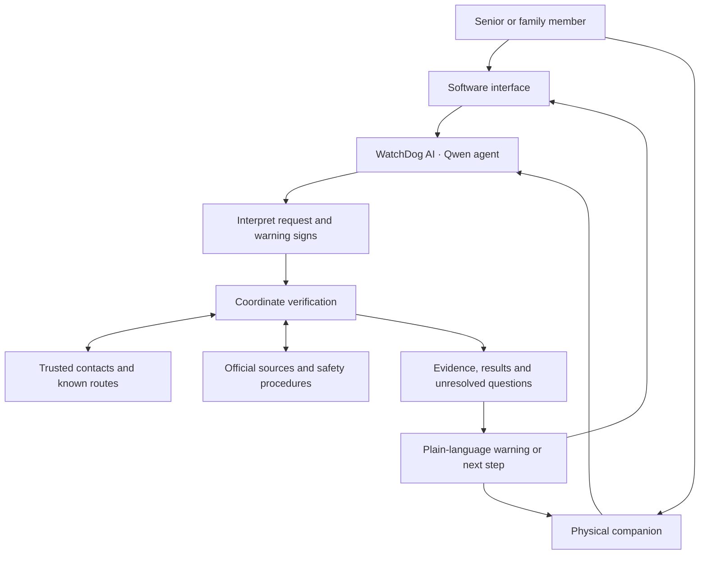

# WatchDog AI — Master Guide

**Team:** Syndicate  
**Track:** Digital Trust  
**Updated:** 19 November 2026  
**Status:** Agreed project direction and team planning reference. Implementation and testing remain to be confirmed.

## 1. Purpose and source of truth

This is the master guide the team follows from now on. Update this document as decisions are agreed so that the team has one current plan.

The initial two briefs remain the foundation:

- [digital-watchdog-team-brief(1).md](https://chatgpt.com/library?file_id=libfile_07de7771906c8191bb81c9b7a22a722b&account_id=personal) — the watchdog concept, trusted context, independent verification, before-and-after support and longer-term direction.
- [problem-statement-digital-trust-seniors(1).md](https://chatgpt.com/library?file_id=libfile_91e83a325e588191b8933dfd8a52502d&account_id=personal) — seniors and families, impersonation, pressure, accessibility and the exploration of physical and digital trust.

The approved direction below guides their synthesis. Later drafts provide implementation ideas for evaluation. Changes to the audience, core concept, scenario or scope require team agreement. This revision supersedes the earlier contents of this master file.

## 2. Approved project description

WatchDog AI is a Qwen-powered AI agent for senior citizens and their families. It helps identify suspected scams, coordinates checks against established safety protocols and trusted sources, and gives suggestions or warnings in plain language to safeguard their money, personal information and digital assets.

Imagine a real dog watching over your safety. WatchDog AI brings that protective presence into your digital experiences, making the evidence behind trust visible.

The ambition is to strengthen digital safety and information integrity through hardware and software working together. The agent coordinates checks in the background and brings clear evidence, uncertainty and suggested actions to the person when their attention is needed.

## 3. Person, problem and inspiration

Puan Salmah is a fictional older Malaysian who relies on familiar phone tools to stay connected with her family. An urgent request that appears to come from someone she loves can make her act before she has time to check.

A familiar voice, account or convincing message can create confidence while leaving the actual request unverified. Under pressure, she needs a simple way to understand the concern and check independently. If she has already clicked, shared information or paid, she needs calm next-step support.

A watchdog notices when something seems out of place within familiar surroundings. This inspires a digital companion that helps people recognise unusual requests and find evidence they can use to decide what to do.

## 4. Priorities

| Priority | Capability | Intended outcome |
| --- | --- | --- |
| 1 | Qwen interprets the supplied interaction, identifies the request and explains observable warning signs. | The senior understands why a check is useful. |
| 2 | The agent selects and coordinates appropriate checks using trusted contacts, official sources and documented safety procedures. | The checking process follows evidence and an explicit procedure. |
| 3 | Show what was checked, its source, its result and what remains unresolved. | The evidence behind trust becomes visible. |
| 4 | Give a plain-language warning or suggested action, including support after someone has acted. | The person can take a meaningful next step. |
| 5 | Connect software checking with an accessible physical companion. | People can request help and receive status or warnings through a familiar physical interaction. |

## 5. Architecture

Architecture describes how the parts work together. This diagram captures the agreed planning direction. Specific integrations remain to be selected and tested.

### Qwen and the agent workflow

Qwen interprets the supplied content and explains the observable evidence in language the user understands. The agent uses that interpretation to select a check, request permission where needed, use an available checking tool, wait for its result and update the guidance.

The software controls permitted actions and records the actual checking results. Every explanation should be traceable to supplied content or returned evidence. When evidence is missing, the result remains unresolved. A family reply applies to the specific request being checked.

### Hardware and software

The software coordinates checking and maintains the evidence and status for the current interaction. The physical companion provides an accessible way to request help and receive feedback. Its form remains open for team agreement, including a button, card or home object with clear feedback.

The original exploration of something the family knows and something they physically hold remains a design question. Any identity-verification role for hardware requires a defined secure connection and a tested procedure. The physical interaction alone cannot establish who sent a digital request.

Background work means the agent carries out the permitted checking sequence after an event or user request. Access to messages, calls or other applications depends on platform capabilities and user permissions.

## 6. First demonstration

Keep the initial team brief's scenario: a familiar account sends an urgent request containing an unfamiliar payment or delivery link. Use the senior's family-impersonation story to explain why this moment matters.

| Stage | Demonstrated behaviour |
| --- | --- |
| Receive | Show a fictional message from a familiar account, its request and link. |
| Understand | Qwen explains the request and points to visible reasons for checking. |
| Check | The agent selects the agreed verification route and coordinates a check. A simulated route must be visibly labelled. |
| Explain | Show the source, result and remaining uncertainty in plain language. |
| Decide | Offer a safe verification step and the person's choice to pause, decline or continue. |
| Support | An “Already clicked” path asks what happened and presents relevant prepared guidance. |

Use sample data. Represent the hardware interaction alongside the software until the physical form is agreed. Demonstrate the complete sequence before adding channels or additional scenarios.

## 7. Safety procedures and evidence

The first implementation needs a concrete selection of safety procedures and official sources. Record each selected source, the check it supports and how its information is obtained.

For the independent-contact path, the proposed procedure is to check through a previously known contact route outside the suspicious interaction. The team must specify how the response is associated with the particular request.

Official reporting or checking services may provide further evidence or support. Confirm their current guidance and access before using them in the demo. Distinguish live results, prepared source material and simulated results on screen. An unavailable check must remain visible as unavailable.

Warnings must explain the observed concern and the evidence supporting it. Avoid blanket assurances about a person, account or link. Recovery guidance needs current, relevant official sources before presentation.

## 8. Relevant supporting work

The later build specification contains reusable ideas for accessible interaction, Qwen interpretation, visible checking status and a labelled demonstration fallback. Its fixed button design, automatic family escalation and family-secret mechanism remain proposals.

The previously referenced external architecture diagram has not been located. The diagram in this guide is the current synthesis of the agreed direction. Review any recovered diagram for useful implementation detail against the two foundational briefs and this plan.

## 9. Completion criteria

- A first-time viewer can follow the flow from receiving the message to a suggested action.
- Qwen's contribution and the agent's checking sequence are visible.
- The viewer can explain what prompted the check, where the evidence came from and what remains uncertain.
- Missing or unanswered checks stay unresolved.
- The user retains control of the next action.
- Hardware and software roles are understandable, with simulated elements labelled.
- The already-clicked path offers relevant next-step guidance.
- The team records which capabilities are implemented, simulated and tested.

## 10. Decisions to settle before implementation

| Decision | Current position |
| --- | --- |
| Name, team and track | WatchDog AI · Syndicate · Digital Trust |
| Audience | Senior citizens and their families |
| Core direction | Qwen agent coordinating checks and explaining evidence through software and a physical companion |
| Demo scenario | Urgent request and unfamiliar link from a familiar account |
| Verification procedure and sources | Select the concrete procedure and authoritative sources for the demo |
| Hardware form | Open; represent the interaction until agreed |
| Qwen model and available checking tools | Confirm access and choose what supports the agreed flow |
| Implementation and test status | To be confirmed by the team |

## 11. Longer-term ambition

Develop a user-controlled layer of protection across calls, messages, links and other digital interactions. Hardware and software should make help accessible while selective, event-triggered checking keeps the experience manageable.

“10× trust” expresses the ambition. Validate progress by observing whether people independently verify requests before acting, understand the evidence, and can identify unresolved checks. Claims about prevention, compute savings or effectiveness require measured results.
